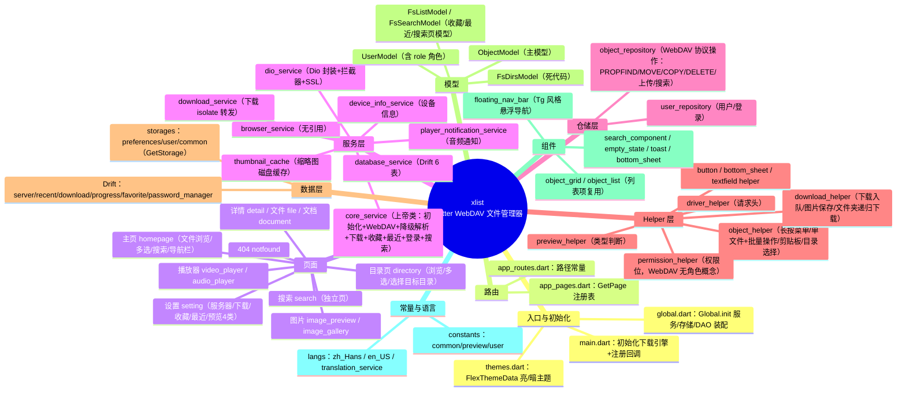

# xlist 项目架构分析脑图报告（PROJECT_MAP）

> **用途**：给 AI（及开发者）快速建立本项目完整心智模型，定位问题、避免重复踩坑。
> **维护规则**：每次 AI/开发者修改任何脚本后，**必须同步更新本文件**（新功能、删除/新增文件、接口变化、死代码清理、矛盾修复都要在此登记）。变更记录见文末「八、变更记录」。
>
> 生成时间：2026-10-15 · 代码规模：lib/ 下 18365 行 Dart，约 160 文件（不含生成文件与依赖）

---

## 一、总览脑图



---

## 二、初始化链（启动装配顺序）

```
main()
 ├─ WidgetsFlutterBinding.ensureInitialized()
 ├─ FlutterDownloader.initialize() + registerCallback(downloadCallback)
 └─ Global.init()
     ├─ Binding（Widgets/Get/SystemChrome）
     ├─ GetStorage：CommonStorage / PreferencesStorage / UserStorage
     ├─ DioService（超时/SSL/拦截器）
     ├─ DatabaseService（Drift：server/recent/download/progress/favorite/password_manager）
     ├─ CoreService（核心，装配上述所有 + thumbnail_cache + device_info + player_notification）
     │   ├─ loadUserData()：从 DB 加载服务器列表
     │   ├─ loadRecentServer()：持久化恢复上次服务器
     │   └─ 首页控制器延迟拉取文件列表
     └─ runApp(XlistApp → GetMaterialApp，初始路由 SPLASH → HOMEPAGE)
```

**要点**：
- `main.dart` 中 `downloadCallback` 为顶层 `@pragma('vm:entry-point')` 函数，经 `downloader_port` isolate 端口转发给下载页控制器。
- 服务器持久化：切换服务器时写 `PreferencesStorage`（serverId/serverUrl/username/password），启动时 `UserStorage.onInit` 恢复。
- 主页列表为延迟 500ms 拉取，保证 CoreService 装配完成。

---

## 三、分层与数据流

```
UI（view） ──GetxController──> Helper（object_helper/download_helper）
                                    │
                                    ▼
                           Repository（object_repository/user_repository）
                                    │        WebDAV：PROPFIND/MOVE/COPY/DELETE/MKCOL/PUT
                                    ▼
                              DioService（Basic 认证 / SSL / 拦截器）
                                    │
                    ┌───────────────┴───────────────┐
                    ▼                               ▼
               WebDAV 服务器                  Drift 本地库（6 表）
                                           + GetStorage（设置持久化）
```

- **认证**：Basic `base64(username:password)`，由 `DriverHelper.getWebDAVHeaders()` / `_getWebDAVOptions()` 注入；`DioInterceptors` 兜底 token。
- **列表请求策略（object_repository）**：轻量 PROPFIND（Depth:1），编码逐段 URL，禁重定向、20s 超时。
- **core_service.getWebDAVFiles**：重诊断版（HEAD 预检 + PROPFIND + 重试 + Depth:0 降级 + GET/Alist/HTML 降级解析），与 object_repository 的列表实现**重复**（见矛盾清单）。

---

## 四、逐模块分析

### 4.1 入口与全局

| 脚本 | 职责 | 合理性 | 问题与解决 |
|---|---|---|---|
| `lib/main.dart`（64 行） | 初始化下载引擎、装配 App | 合理；下载引擎初始化是本项目多次踩坑后补上的关键 | ①`downloadCallback` 需保持顶层函数（isolate 要求）；②主题固定 `ThemeMode.light` 与设置页主题项矛盾（见矛盾清单） |
| `lib/global.dart`（266 行） | Global.init 全链路装配 | 合理，但代码过长（200+ 行初始化 + 大量 print） | 建议抽 `AppAssembler`；print 应统一走 Logger |
| `lib/themes.dart` | FlexThemeData 亮/暗主题 | 合理 | 暗色仅在代码中可用，App 未提供暗色切换（ThemeMode.light 固定） |

### 4.2 路由

| 脚本 | 职责 | 合理性 | 问题与解决 |
|---|---|---|---|
| `app_routes.dart` | 路径常量（含 `_Paths`） | 合理 | 曾误删 `RECENT` 常量导致编译错误——改路由时必须同步两侧 |
| `app_pages.dart` | GetPage 注册 | 合理 | 11 个页面注册；删除页面需同步删 import+GetPage+路由常量（关于页已按此清理） |

### 4.3 页面

| 页面 | 脚本（行数） | 功能 | 合理性 | 问题与解决 |
|---|---|---|---|---|
| 主页 | controller 419 / view 618 | 文件浏览（网格/列表）、排序、多选+批量操作栏、地址栏搜索/导航、Tg 悬浮导航栏（多选/排序/布局/刷新/下载/设置） | **职责过重**：controller+view 超 1000 行 | ①地址栏输入承担「路径导航 + 全局搜索」双职，与独立搜索页重复（见矛盾）；②建议拆分搜索逻辑到 SearchService；③多选状态曾因 keframe 缓存不刷新，已用列表 key 绑定多选态解决 |
| 目录页 | controller 229 / view 544 | 二级目录浏览、多选、作为「移动/复制目标选择器」 | 合理，view 偏大 | 目标选择模式（selectMode）与浏览模式耦合在同一页，靠参数切换，建议拆 `select_mode` 视图组件 |
| 视频播放 | controller 722 / view 348 | 在线播放、**播放地址探测解析（去 /dav/）**、进度记录、播放列表 | 控制器过大（722 行） | ①与音频控制器大量重复（见矛盾）；②播放器失败兜底已改为「Range 探测选流式地址再播」 |
| 音频播放 | controller 618 / view 496 | 在线播放、通知栏（audio_service）、播放列表 | 同上 | 同上；`PlayerNotificationService` 容错获取，video 侧未启用 |
| 图片预览 | controller 195 / view 204 | 单图预览/轮播 | 合理 | 缩略图/认证头复用 thumbnail_cache |
| 图片画廊 | image_gallery_page | 图片集合 | 合理 | 简单页面 |
| 详情页 detail | view 157 | 展示文件信息 + 收藏/最近/下载入口 | 合理 | 调用 `coreService.addToFavorites/addToRecent/downloadObject`（见矛盾清单：downloadObject 是假下载） |
| 文件页 file / 文档页 document | 小页面 | 本地文件/文档打开 | 合理 | 与预览类型联动 |
| 独立搜索页 search | controller 77 / view 192 | 独立搜索 | **失效**：`getSearchObjectList` 调 `coreService.searchObjects`（恒返回 []，注释“模拟数据”）→ 页面永远空 | **解决**：复用主页的轻量并发搜索逻辑（`ObjectRepository.getList` + 并发递归），或删除该页统一到主页搜索 |
| 设置页 | view 308 | 服务器/下载/收藏/最近/预览4类/主题 | 合理 | 主题项 `themeMode` 切换不生效（main 固定 light） |
| 服务器页 | controller 374 / view 207 | 增删改查服务器、切换持久化 | 合理 | 已修切换不持久化；服务器连接测试用 HEAD |
| 下载管理页 | controller 195 / view 287 | 下载列表、进度条/速度/暂停/恢复/分享/删除 | 合理（已恢复引擎） | 曾因 flutter_downloader 未初始化整体失效，已修 |
| 收藏/最近页 | controller 各 ~140 | 展示收藏/最近条目 | **逻辑矛盾**：条目点击后 `getList(path: entity.path)`，但 `entity.path` 存的是 **rawUrl（完整 http 地址）**，被当 WebDAV 路径再拼接 → 404 | **解决**：收藏/最近应存「服务器路径」（path+name 相对路径），读取时用该路径列目录，或直接本地展示实体 |
| 404 | notfound | 兜底 | 合理 | - |

### 4.4 服务层

| 脚本（行数） | 职责 | 合理性 | 问题与解决 |
|---|---|---|---|
| `core_service.dart`（1966） | **上帝类**：服务装配 + WebDAV 列表（重诊断）+ XML/GET/HTML/Alist 降级解析 + 下载 + 收藏 + 最近 + 登录 + 搜索 + 导航 | **职责过多、耦合最高** | **解决**：①列表/降级逻辑迁入 object_repository（已有轻量版，统一入口）；②下载/收藏/最近收编到对应 helper/repository；③core_service 只保留装配与状态。这是本项目最重要的重构点 |
| `dio_service.dart`（99） | Dio 单例 + 超时 + SSL + 拦截器 | 合理 | 全局 receiveTimeout 300s 偏长；写操作已用 Options 级 20s 覆盖 |
| `database_service.dart`（283） | Drift 初始化/尺寸/重置 | 合理 | - |
| `download_service.dart`（40） | isolate 端口转发 | 合理 | 端口名 `downloader_port` 必须与 main.dart 一致 |
| `player_notification_service.dart`（193） | audio_service 通知处理 | 半活跃 | 仅音频播放器用；video 已注释引用 |
| `thumbnail_cache.dart`（258） | 缩略图磁盘缓存 | 合理 | 有 print 需清理 |
| `browser_service.dart`（45） | ChromeSafariBrowser/InAppBrowser | **死代码：零引用** | 删除或接入浏览器打开场景 |
| `device_info_service.dart`（~30） | 设备信息 | 待确认引用 | 若无用则删除 |

### 4.5 仓储层

| 脚本（行数） | 职责 | 合理性 | 问题与解决 |
|---|---|---|---|
| `object_repository.dart`（501） | WebDAV 协议全操作：PROPFIND/MOVE/COPY/DELETE/MKCOL/PUT/搜索 | **合理、应作为协议唯一入口** | 已含：逐段 URL 编码、禁重定向、20s 超时、207 解析 |
| `user_repository.dart` | 用户/登录 | 合理 | - |

### 4.6 Helper 层

| 脚本（行数） | 职责 | 合理性 | 问题与解决 |
|---|---|---|---|
| `object_helper.dart`（1001） | 长按菜单 + 单文件/批量移动复制删除重命名 + 剪贴板粘贴 + 目录选择 + 文件属性 | **大而全，UI+业务+状态混合** | ①剪贴板为全局静态状态（_clipboardData），多页面共享有并发风险，建议收敛到 GetxService；②曾缺 dismiss 致 loading 不消失（已修）；③cut 已改即时选目录 |
| `download_helper.dart`（273） | 下载入队（FlutterDownloader）/图片保存/文件夹递归下载 | 合理 | 与 `core_service.downloadFile`（假下载）形成双路径矛盾 |
| `driver_helper.dart` | 请求头构造 | 合理 | - |
| `preview_helper.dart` | 扩展名类型判断 | 合理 | - |
| `permission_helper.dart`（~26） | UserModel.role 权限位 | **半死**：isAdmin/isGeneral/isGuest/canSeeHides/canOfflineDownload/canAccessWithoutPassword/canWrite 无引用；仅 canRename/canMove/canCopy/canDelete 在 UI 用 | WebDAV 无角色概念，建议删除未用方法，UI 权限判断简化为「登录即可」 |
| `button_helper.dart` / `bottom_sheet_helper.dart` / `textfield_helper.dart` | UI 工具 | 合理（有引用） | - |

### 4.7 数据层

| 模块 | 内容 | 合理性 | 问题与解决 |
|---|---|---|---|
| Drift 6 表 | server/recent/download/progress/favorite/password_manager | 合理 | 收藏/最近的 path 字段存 rawUrl 导致回读失败（见矛盾） |
| `storages/preferences_storage.dart` | 设置项（排序/布局/播放器开关/忽略SSL/服务器） | 合理 | `.val` 自动持久化，切换即写盘 |
| `storages/user_storage.dart` | 当前用户/服务器内存态 | 合理 | onInit 从 Preferences 恢复 |
| `storages/common_storage.dart` | clipboardText / themeMode | **themeMode 被设置页读但无效；clipboardText 零引用** | themeMode 需接入 main 主题切换或删除；clipboardText 删除 |

### 4.8 组件层

| 组件 | 职责 | 合理性 | 问题与解决 |
|---|---|---|---|
| `floating_nav_bar.dart` | Tg 风格悬浮胶囊导航 | 合理（已重构） | 多选入口在此；交互层用 GestureDetector(opaque) |
| `object_grid_item.dart` / `object_list_item.dart` | 列表项 | 合理 | 与 keframe FrameSeparateWidget 组合，排序/多选需 key 强制重建（已处理） |
| `search_component.dart` | 搜索框（跳独立搜索页） | **矛盾**：跳转的搜索页是失效的 | 改为跳主页搜索或修复搜索页 |
| `empty_state.dart` / `toast_component.dart` | 空态/Toast | 合理 | - |

### 4.9 模型层

| 模型 | 用途 | 合理性 | 问题与解决 |
|---|---|---|---|
| `ObjectModel` | 主文件模型 | 合理 | - |
| `UserModel` | 用户（含 role） | role 无实际来源 | WebDAV 无角色；若登录接口不返回 role，权限判断恒失败 |
| `FsListModel` / `FsSearchModel` | 收藏/最近/搜索页 | 合理但冗余 | 与 ObjectModel 字段重叠，建议统一为 ObjectModel |
| `FsDirsModel` | - | **死代码：零引用** | 删除（含 dirs.g.dart） |

### 4.10 常量与语言

- `constants/common.dart`：排序/文件类型/页面源等；`preview.dart`：可预览类型清单；`user.dart`：UserRole/权限位。
- `langs/zh_Hans.dart` / `en_US.dart` / `translation_service.dart`：i18n。新增文案需双语同步，否则英文环境缺 key。

---

## 五、耦合度分析

### 高耦合关系图

```
                     ┌─────────────────────────────┐
                     │   core_service（上帝类）      │←─ homepage/directory/search/favorite/recent/
                     │  1966 行，几乎被所有模块依赖   │   detail/download/player 全部控制器
                     └──────┬──────────┬───────────┘
              WebDAV列表重复 │          │ 下载/收藏/最近（与 helper 重复）
                     ┌──────▼──┐   ┌───▼────────┐
                     │object_   │   │ object_helper│←─ 所有页面长按菜单/批量操作
                     │repository│   │ 1001行      │
                     └─────────┘   └────────────┘
```

### 高耦合点与解决

| 耦合点 | 现状 | 危害 | 解决 |
|---|---|---|---|
| core_service 承担协议+业务+装配 | 上帝类 | 改一处影响全局；两套 WebDAV 列表实现行为不一致 | 列表/降级统一到 object_repository；业务收编 helper/repository；core_service 只做装配与状态 |
| object_helper 混合 UI+业务+剪贴板状态 | 全局静态剪贴板 | 多页面共享可变状态，易错 | 剪贴板抽 GetxService（ClipboardService） |
| homepage/directory 各自实现网格/列表 | view 大量重复 | 样式/行为漂移 | 复用 object_grid/list 组件（已部分复用），视图构建函数抽公共 Widget |
| video/audio 控制器高度相似 | 播放逻辑重复 | 修一处忘另一处 | 抽公共 PlayerController 基类（初始化/地址解析/进度/播放列表） |
| 双搜索（主页内联 + 独立页） | 逻辑分叉 | 体验不一致 | 统一到一处（推荐保留主页并发轻量搜索，删除独立页或复用它） |

---

## 六、死代码清单（已确认，含解决）

| 位置 | 内容 | 证据 | 解决 | 状态 |
|---|---|---|---|---|
| `lib/models/fs/dirs.dart` | FsDirsModel | 全项目零引用（仅 .g.dart 生成） | 删除文件 + dirs.g.dart | ✅ 已删（含 dirs.g.dart + models/index.dart export） |
| `lib/services/browser_service.dart` | BrowserService/DeupChromeSafariBrowser/DeupInAppBrowser | 零引用 | 删除 | ✅ 已删（含 services/index.dart export） |
| `core_service.getMockWebDAVFiles` | mock 列表 | 唯一调用处已被注释 | 删除 | ✅ 已删（含 homepage 注释行） |
| `core_service.searchObjects` | 恒返回 `[]` | 「这里可以添加搜索逻辑」 | 删除（搜索页已改用轻量并发递归） | ✅ 已删 |
| `core_service.downloadFile` / `downloadObject` | 假下载：taskId 用时间戳、不真实下载 | 与 DownloadHelper 真下载并存 | 删除，统一走 DownloadHelper | ✅ 已删（file/视频播放器已改真下载） |
| `core_service.addToFavorites/addToRecent` 的 rawUrl 存储 | 存完整 URL 作 path | file/视频页仍在用但语义错误 | 加 `path` 参数存相对路径 | ✅ 已修（file/视频页传父目录 path） |
| `DetailController/DirectoryController/HomepageController` 的 addToFavorites/addToRecent/downloadObject | 死方法链（无 UI 调用） | grep 无调用方 | 删除 | ✅ 已删 |
| `ObjectHelper` 剪贴板机制（ClipboardOperation/_clipboardData/paste/cut/clipboardData getter） | 死代码：move/copy/cut 已改选目录即执行，粘贴入口永不显示 | 主页长按空白+菜单粘贴块守卫恒 false | 删除整条剪贴板机制 | ✅ 已删（含 homepage/directory 的粘贴入口） |
| `ObjectHelper._selectDirectory` | 跳转后拿不到返回值，移动/复制永不执行 | 返回 null → if 不成立 | 删除（统一走目录页 moveOrCopy） | ✅ 已删 |
| `ObjectHelper.batchMoveOrCopy` | 批量移动/复制死路径（同样 _selectDirectory 返回 null） | 主页/目录页多选后失效 | 删除，改跳目录页批量执行 | ✅ 已删 |
| `ObjectRepository.search` | 无调用方（搜索页已改 _searchRecursive） | grep 无调用方 | 删除 | ✅ 已删 |
| `permission_helper` 部分方法 | isGeneral/isGuest/canSeeHides/canOfflineDownload/canWebdavRead/canWebdavManage | 零引用 | 删除未用方法 | ✅ 已删 |
| `common_storage.clipboardText` | 剪贴板文本存储 | 零引用 | 删除 | ✅ 已删 |
| `core_service.downloadService` 字段 + `_initOtherServices()` 占位 | 恒为 null（从未初始化），detail/file/video_player 的 `if (x != null)` 死分支 | 本轮 detail/file/video_player 已统一改 `DownloadService.to` | ✅ 已删（字段+方法体+调用点） |
| `video_player` 中注释的 audioHandler | 通知栏逻辑 | 注释代码 | 清理注释 | ⏳ 保留（注释无害，后续随播放器重构处理） |

---

## 七、矛盾清单（已确认，含解决）

| # | 矛盾 | 影响 | 解决 | 状态 |
|---|---|---|---|---|
| 11 | **DeviceInfoService/DownloadService 从未注册**：Global.init 只注册存储/DAO/CoreService；`DeviceInfoService.to`/`DownloadService.to`（Get.find）任何调用即抛异常 | ①长按菜单点"下载"→ checkPermissionStorage 访问 androidInfo 抛异常 → 传播到菜单 catch → 误报"菜单显示失败"；②下载页/audio/document/detail/file/video 页 bindBackgroundIsolate 打开即崩或永不执行 | Global.init 注册两个服务（Get.putAsync + init）；checkPermissionStorage 额外 try-catch 容错；下载/详情等页统一 `DownloadService.to` | ✅ 已修 |
| 12 | **列表 keframe 帧缓存无数据版本**：KeyedSubtree key 只含布局/排序/多选，不含数据变化 | 重命名/刷新后旧帧缓存不重建（列表不自动刷新）；点击旧对象打开慢 | controller 增加 `dataVersion`（列表更新时 +1），key 追加该维度（homepage/directory） | ✅ 已修 |
| 1 | **主题切换无效**：设置页可切 themeMode，main 固定 `ThemeMode.light` | 用户切主题无反应，重启不恢复 | main 读取 `commonStorage.themeMode` 动态设置 themeMode | ✅ 已修（main.dart 恢复持久化主题） |
| 2 | **独立搜索页恒空**：SearchComponent 跳独立搜索页，但该页 `coreService.searchObjects` 恒空 | 用户从搜索框进入看到空页面 | 搜索页复用主页轻量并发递归（深度8/上限500/45s超时/防抖400ms） | ✅ 已修（另修复搜索页 basePath 空断言崩溃点） |
| 3 | **收藏/最近打不开**：读取端 `getObjectList` 对文件多减一级目录（dirname 父目录）、对文件夹未拼自身名 | 收藏/最近条目点击即 404 | 读取端直接列父目录（文件）或拼 `${path}/${name}`（文件夹）；写入端统一父目录 path + 文件名 | ✅ 已修 |
| 4 | **假下载**：core_service.downloadFile 只插库不真下载（file 页/视频播放器受影响） | 点了"下载"实际没下载 | file/视频页 download 改走 DownloadHelper.file 真下载 | ✅ 已修 |
| 5 | **单文件移动/复制/剪切失效**：长按菜单 move/copy/cut 走 _selectDirectory（跳转拿不到返回值）→ 永不执行；目录页"粘贴到此处"依赖已死剪贴板 | 移动/复制/剪切全部无效 | 统一跳目录选择页（带 srcDir/srcObject/isCopy），"粘贴到此处"调 confirmPaste()/moveOrCopy() 执行并返回 | ✅ 已修 |
| 6 | **批量移动/复制失效**：batchMoveOrCopy 同样 _selectDirectory 返回 null 直接 return | 多选后"移动/复制"无反应 | 主页/目录页多选后跳目录页（带 srcObjects 列表），新增 confirmPaste() 遍历执行 | ✅ 已修 |
| 7 | **两套列表解析**：core_service.getWebDAVFiles（重诊断+降级）与 object_repository.getList（轻量 PROPFIND） | 行为/解析不一致 | 搜索统一走轻量接口；core_service 重诊断版保留用于主页首载（待后续收敛） | ⏳ 记录待重构 |
| 8 | **权限模型与 WebDAV 不符**：UserModel.role + 权限位，WebDAV 登录不返回角色 | 权限判断可能恒拒/恒放 | 未动（保留 canWrite/canRename/canMove/canCopy/canDelete 用于 UI 控制，WebDAV 下 user.permission 为 0 时仅 admin 放行） | ⏳ 记录待重构 |
| 9 | **视频/音频播放器逻辑重复** | 修复单边 | 抽公共播放器基类 | ⏳ 记录待重构 |
| 10 | **FsListModel/FsSearchModel 与 ObjectModel 并存** | 字段映射转换易错 | 统一模型（保留 ObjectModel，Fs* 仅作兼容壳） | ⏳ 记录待重构 |
| 5 | **权限模型与 WebDAV 不符**：UserModel.role + 权限位，但 WebDAV 登录不返回角色 | 权限判断可能恒拒/恒放 | 简化：登录成功即视为可操作；删除 role 相关死方法 |
| 6 | **两套列表解析**：core_service.getWebDAVFiles（重诊断+降级）与 object_repository.getList（轻量 PROPFIND） | 行为/解析不一致（搜索曾用重版慢到"搜不出"） | 统一列表入口到 object_repository；core_service 不再直接发 WebDAV 请求 |
| 7 | **FsListModel/FsSearchModel 与 ObjectModel 并存** | 字段映射转换易错 | 统一模型（保留 ObjectModel，Fs* 仅作兼容壳） |
| 8 | **视频/音频播放器逻辑重复** | 修复单边 | 抽公共播放器基类 |

---

## 八、变更记录（每次修复后必须在此登记）

| 日期 | commit | 变更摘要 |
|---|---|---|
| 2026-10-15 | 386b2ea | 初始生成本脑图报告（v1.0.x 现状基线） |
| 2026-10-15 | ce7aee2 | **项目自检修复（A~G）**：①收藏/最近读取端路径修复（文件列父目录/文件夹拼自身名）；②独立搜索页真搜索（轻量并发递归+防抖+basePath 崩溃防护）；③主题切换持久化生效；④假下载删除，file/视频页下载改 DownloadHelper 真下载；⑤收藏/最近写入端统一父目录 path+文件名；⑥单文件移动/复制/剪切统一走目录选择页；⑦批量移动/复制跳目录页遍历执行（新增 confirmPaste）；⑧死代码清理：FsDirsModel、browser_service、getMockWebDAVFiles、searchObjects、downloadFile/downloadObject、三个 controller 死方法、ObjectHelper 剪贴板整条机制、_selectDirectory、batchMoveOrCopy、ObjectRepository.search、permission_helper 未用方法、clipboardText |
| 2026-10-15 | 待推送（自检H~K） | **本轮 4 项修复 + 自检追加**：①废除启动画面残留（删 Routes.SPLASH/_Paths.SPLASH，notfound 改跳 HOMEPAGE）；②修复长按菜单"下载"报"菜单显示失败"（根因：DeviceInfoService/DownloadService 从未注册 → Global.init 补齐注册 + checkPermissionStorage 容错 + download case 独立 try-catch）；③修复重命名后列表不自动刷新/点不开（列表 key 加 dataVersion 数据版本，homepage/directory）；④修复缓存清理：网络图片缓存改 DefaultCacheManager().emptyCache() 全局清除（不再依赖视频播放器 controller，flutter_cache_manager 提升为直接依赖）+ 显示清理 MB；⑤自检追加：detail/file/video_player 的 coreService.downloadService 死分支统一改 DownloadService.to，删除 core_service.downloadService 字段与 _initOtherServices 占位；⑥修 user_storage.dart dead_null_aware_expression；⑦DatabaseService.close/reset 无调用方，作为 API 预留保留 |
| 2026-10-15 | 待推送（bug批次） | **4 项用户 bug + 自检 skill 化**：①搜索闪退修复（根因：递归对全部子目录无并发上限同时发 PROPFIND → 内存/连接爆 → 分批并发每批 10 个，homepage/search 双侧；搜索项空断言防御；ObjectHelper.click 文件夹分支 Get.find 容错降级目录页）；②连接错误统一背景（新增 ConnectionErrorView 组件：品牌渐变+logo 水印+少量文字+重试，homepage 错误态接入，替代生硬 EmptyState 报错）；③目录选择页网格间距对齐主页（maxCrossAxisExtent 280.w / mainAxisExtent 100 / spacing 0·8）；④导航栏多选移除并入长按菜单（长按菜单新增"多选"项按 source 切换对应 controller）；⑤自检 skill 沉淀 `docs/skills/self-check-repair/SKILL.md`（通用自检-修复-验证-推送闭环，适用于任何项目） |
| 2026-10-15 | 待推送（v2批次） | **用户 6 项 + 发布流程完善**：①缓存清理区分：改"清除缩略图缓存（列表缩略图/预览预取）"与"清除网络图片缓存（预览大图/封面）"，文案+副标题明确区别；②移除 Android 12+ 系统 SplashScreen logo 一闪（新增 values-v31/values-night-v31 + 透明 splash drawable）；③图片查看器加速：图片链接并发获取（Future.wait 替代逐张串行 get）、缩略图只预取当前±2 张；④应用彻底改名 CloudX：MaterialApp title + langs app_name + 确认 manifest label；⑤CI release 发布说明：body 改为自动取最近提交信息（修复了什么/做了什么）+ 名称改 CloudX；⑥新增详细 README（功能/安装/构建/架构/CI/已知限制），标注"本项目由纯 AI 构建" |
| 2026-10-16 | 待推送（v6-多选/缓存） | ①删除进入/退出多选 toast（homepage+directory toggleSelectMode/enterSelectMode）；②清除文件缓存：提示词与标题统一为"已清除文件缓存"，逻辑补齐为缩略图缓存+网络图片缓存一并统计并清理 |
| 2026-10-16 | 待推送（v6-搜索框修复） | 顶栏搜索框不可点击/无法输入：Obx+每次 build 新建 TextEditingController，输入触发重建导致失焦（看似灰色禁用）。改为 StatefulWidget _HomeSearchField 持稳定 controller，onChanged/onSubmitted/搜索按钮回调保留 |
| 2026-10-16 | 待推送（v6批次） | ①下载管理排版：路径单独一行、大小与状态一行（上下排）；②下载默认目录改系统下载目录 Download/CloudX/图片|视频|音乐|文档|压缩|文件（按扩展名分类，系统 APP 可打开）；③重命名对话框改 Cupertino 自定义（默认选中不含后缀的主体，autofocus）；④播放错误已有错误视图不再重复弹 toast（video/audio controller 删 3 处冗余 toast）；⑤最近浏览点击文件直接本地索引秒开（不再网络加载父目录） |
| 2026-10-16 | 待推送（v5-搜索框） | 顶栏搜索框在错误页等深色背景下隐形（三层黑）。已提高对比度：深色模式搜索框背景提亮 #2E2E34 + 白色半透明描边 + placeholder/搜索图标白色系，各页面清晰可见 |
| 2026-10-16 | 待推送（v5批次） | ①所有错误页统一图二审美（ConnectionErrorView 支持自定义标题/提示，视频播放失败、音乐播放失败接入）；②修复服务器地址无法保存/新建无效（根因：DB v3→4 缺 migration，旧库升级失败全部写入不可用，已补 migration3to4 建 file_index 表）；③持久化库与索引库分库：新建独立 IndexDatabase（xlist_index.db，version 1 仅 FileIndexEntity）+ IndexDatabaseService（GetxService），FileIndexService 全部改走索引库；主库 xlist_database.db 保持 v4（含 file_index 表兼容已装用户，业务表正常读写） |
| 2026-10-16 | 待推送（v4-连接错误页） | 连接错误页统一为图二（空状态）风格：ConnectionErrorView 纯色背景 + 简约插画（Assets.images.empty）+ 简短提示 + 重试，去掉长报错文本（PROPFIND/GET 均失败等不再展示），与"没有下载文件"等空状态视觉一致 |
| 2026-10-16 | 待推送（v4批次） | **用户 12 项**：①二级导航栏与一级对齐（bottom 16 + 同高）；②移动=剪切（概念说明）；③粘贴完成返回长按前来源界面（目录选择页子目录用 Get.to 叠加路由导致 Get.back 只弹一层 → 全部跳转传 fromRoute，粘贴后 Get.until 回退到来源路由）；④一级下载图标更换（arrow_down_circle）；⑤二级"下载"改名"下载文件"；⑥重命名跳回首页修复（refreshObjectList 的 HOMEPAGE 分支 getObjectList(path: currentPath) 保持当前目录）；⑦多选列表反复刷新修复（列表 key 去掉 selectedObjects.length）；⑧下载管理器/播放器逻辑检查（Range 探测、速度监听无回归）；⑨下载页文字溢出修复（750.w 固定宽改 Expanded 自适应）；⑩下载完成点击非音视频文件用 open_filex 调系统应用打开（新增依赖）；⑪新增本地文件索引（floor 表 file_index + FileIndexDao + FileIndexService；浏览 homepage/directory/detail 自动写入；搜索先查索引毫秒返回、无结果联网兜底；删除/批量删除/重命名同步清理或更新索引；DB version 3→4）；⑫顶栏搜索框只显示"搜索"灰字提示（不再显示路径名） |
| 2026-10-16 | 待推送（v3批次） | **用户 6 项**：①缓存标题简化（去掉溢出的 additionalInfo，"清除缩略图缓存"/"清除文件缓存"）；②建立 CHANGELOG.md 修复记录机制（每轮修复后追加，版本对应 Release tag）；③长按菜单重构为二级导航栏：长按直接进多选+选中该文件，底部显示与导航栏同款 UI 的 FloatingActionBar（新增组件，横向可滑动；属性/下载/移动/复制/剪切/删除/重命名/复制链接/完成），homepage/directory 双侧统一，删除旧的 showModalActionSheet 菜单（showContextMenu 死代码清理）；安卓 PopScope 拦截侧滑返回：多选模式先退出多选与二级栏；④修复长按下载失败（根因 DownloadHelper.getDownloadUrl 路径拼接缺 `/` → `/视频`+名 → 404 → "文件下载失败"，补斜杠）；⑤修复粘贴后不退出目录选择页（单文件 moveOrCopy 后 Get.back）；⑥修复删除后不刷新（refreshObjectList 移除危险的 Get.until 回跳 + try-catch 兜底，remove/batchDelete 均已带刷新） |

---

## 九、给 AI 的修复守则（本仓库迭代约定）

1. **改代码先查本报告**：涉及 core_service/object_helper 的改动先评估耦合影响；涉及播放器改动要 video+audio 双侧同步。
2. **新增/删除文件必须登记**：更新第四、六、七、八节。
3. **WebDAV 请求一律走 object_repository**（逐段编码/禁重定向/20s 超时），不新开协议实现。
4. **写操作（移动/复制/删除/重命名）成功后必须 `SmartDialog.dismiss()`**，否则 loading 不消失（历史 bug）。
5. **keframe 缓存坑**：列表按 index 缓存帧，排序/多选/布局变化必须给列表 key 绑定相关状态强制重建。
6. **播放地址坑**：部分服务器（CF Workers）对 `/dav/` 路径返回下载头，播放器需 Range 探测选流式地址（原地址 → 去 dav 地址）。
7. **搜索用轻量并发递归**（ObjectRepository.getList + 同层 Future.wait + 深度8 + 上限500 + 45s 超时），勿复用 core_service 重诊断接口。
8. **推送**：`git push origin main`（凭据在沙箱 `~/.git-credentials`，勿在命令/日志中带 PAT）。
